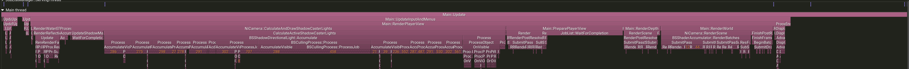
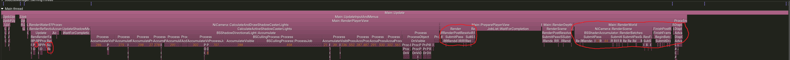
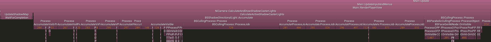
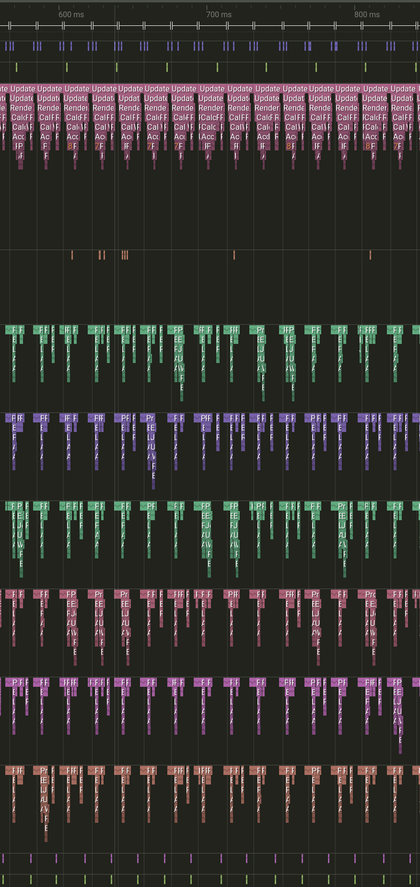
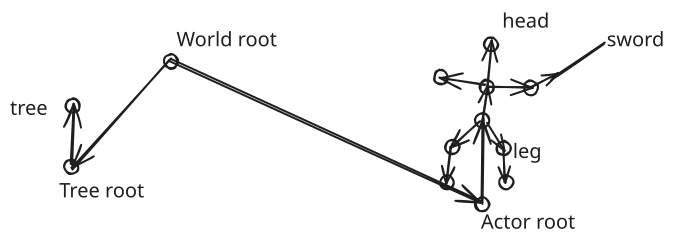
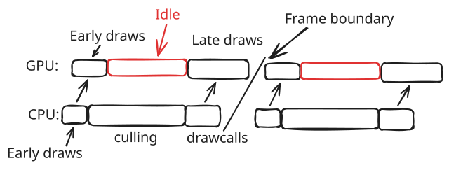
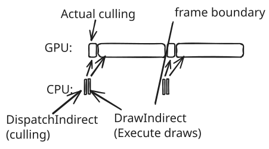

Skyrim has a well-known scaling issue tied to the number of objects in the scene. This has commonly been called the 'drawcall limit'. The purpose of this article is to explore several things, including:

- What the cause of this issue actually is (actual API draw calls are only a small part)
- Other closely-related issues that cause Skyrim to scale poorly, even with hardware multiple times faster than what the game was designed to run on
- How modern renderers avoid these issues
- How we can implement a modern replacement for Skyrim's frame pipeline, finally resolving many of Skyrim's scaling issues

{/* truncate */}

## Profiling a frame

First, we'll start with how the SSE-era Creation Engine assembles a frame on the CPU and submits it to the GPU (discovered using a combination of reverse-engineering through Ghidra, Nsight Graphics, and lots of Tracy zones). All timings here will be for a 9800X3D- meaning, basically the best CPU currently available for Skyrim, on the bridge outside Riverwood, with the SREX mod installed.

Here's a top-level overview of one frame in Tracy (one color represents one thread, horizontal bars are functions, callers above callees):

This frame took ~18ms, with `Main::RenderPlayerView` taking 14.5ms. People familiar with computer graphics may be able to pick out some things that are interesting here, but given the fact that we're talking about fixing the 'drawcall limit', we should probably start with where the drawcalls are (and *what* they are).

## What is a drawcall?

The Skyrim modding community has commonly used "draw calls" as a catch-all term for "what the engine does to tell the GPU to draw something". This is not *technically* incorrect, but there is a lot more to drawing an object in DX11 than simply sending a single command. In general, there will be three things that happen for each object in the scene in a standard DX11 renderer. Those are:

1. Checking if the object is even visible (culling)
2. Setting up the global DX11 state for that object (binding buffers, textures, etc.)
3. Submitting the actual drawcall

The first is a purely application-side operation- the DX11 driver has no involvement in deciding what objects the engine actually sends to the API. The second and third require DX11 API calls (the exact list of available commands can be found here: https://learn.microsoft.com/en-us/windows/win32/api/d3d11/nn-d3d11-id3d11devicecontext). From here on:

- When I say "API command", I mean something on that list from the DX11 docs. 
- When I say  "drawcall", I mean specifically one of the API commands that specifically draws an object with the currently active API state ([ID3D11DeviceContext::Draw](https://learn.microsoft.com/en-us/windows/win32/api/d3d11/nf-d3d11-id3d11devicecontext-draw), [ID3D11DeviceContext::DrawIndexed](https://learn.microsoft.com/en-us/windows/win32/api/d3d11/nf-d3d11-id3d11devicecontext-drawindexed), [ID3D11DeviceContext::DrawIndexedInstanced](https://learn.microsoft.com/en-us/windows/win32/api/d3d11/nf-d3d11-id3d11devicecontext-drawindexedinstanced), [ID3D11DeviceContext::DrawInstanced](https://learn.microsoft.com/en-us/windows/win32/api/d3d11/nf-d3d11-id3d11devicecontext-drawinstanced)), etc, or an indirect or Vulkan variant of such.

In order to approach fixing Skyrim's CPU limitations, we must distinguish between things that the Creation Engine does to keep track of its own objects (step 1), and things it does directly relating to DX11 (submitting API commands, including drawcalls). This will inform where we need to focus to improve things, and exactly how much of the Creation Engine we need to rip apart to do so.

## Where the frame time goes

Let's start back with the Tracy view from earlier. With how much of the conversation has been focused on "drawcalls" so far, surely the engine spends most of its time submitting them, right? But something is off immediately- DX11 should be capable of pushing hundreds of thousands of actual drawcalls per frame at minimum- certainly more than the ~10k that seems to be the limit even today, with very fast CPUs. Well, circled below in red are the areas where the engine actually submits *any* DX11 API calls *at all* (many more than just drawcalls):

That's it.
Even if we completely deleted those regions, reducing API command cost to zero and assuming the engine does nothing else useful in those regions, we would save at best maybe a fifth of the current frametime. This is why attempts to fix this issue by using DX11 slightly more efficiently (e.g with DX11's command lists and multithreaded recording) are fundamentally short-sighted- clearly, actual API submissions are *not* the biggest issue with this renderer. We need to go deeper, starting with what in the heck that giant region in the middle is:

This is where the game handles the first of the three earlier steps (what is visible)- specifically, this is the place where the game calculates, for each shadow map, which objects are in view of that light, and need to be rendered into its shadow views. There are similar regions for main-camera and reflection-cubemap culling, though they are smaller. So, is that it? We just need to make this process multithreaded (calculating culling on more threads), and we'll fix the issue?

### Why more CPU threads are not enough

Well, here's an expanded view of the Tracy window:

See all those other colors? Those are other threads, all participating in the view accumulation and culling process, as well as other various scene jobs like animation graph updates. This is where we hit on an understandable misconception among Skyrim players- Skyrim's renderer isn't *really* single-threaded. It *will* make use of more threads to perform culling- the only part that's *really* single-threaded by nature is API command submission, and we've already determined that that issue is small compared to the rest of what's going on.

## The cost of repeated scene traversal

By now, it's pretty clear how the game's render pipeline works at a high level (CPU culling, then command submission), but how does it actually determine what's in the scene? What is culling actually doing?

Well, it works roughly like this. The scene (all objects, which objects are attached to which other objects) is stored in memory in a "scene graph". Imagine a simplified game where you have just an empty world, with a player and a tree. A simplified scene graph for that might look something like this:

Each circle is a node in the graph, and the edges are the parent-child relationships. To figure out what it should render, the game starts at the root node of the world, and checks each of its children. If its children have children, it checks them too, until it runs out of things to check. If, at any point, it encounters something that is a renderable entity (has a mesh, and isn't some kind of debug marker), it queues it for rendering. Bethesda calls this process "accumulation", and culling is performed as part of it (skipping graph children whose bounding volume is off-screen). This is repeated for every single view in the frame. One main camera, four shadow cascades, and four hemispherical point lights? You're repeating this process *thirteen times per frame* (1 + 4 + (4 × 2)), and the larger the world-space size of a given shadow casting light is, the more objects it needs to accumulate before running out of relevant scene children.

### Requirements for a replacement

This is certainly a *functional* way of deciding what to draw, and was fairly standard until maybe ~2013-2015 (though Bethesda's implementation of it is uniquely slow), but over the last decade, all major studios have abandoned this approach for deciding what to draw in a given frame in large-scale open-world games, and if we're going to be redesigning things, we might as well do it right. To get the best long-term solution, we need to accept a few things upfront:

1. We cannot afford to do full-scene iteration (and *especially* not graph traversal) on the CPU. Not even once. Not even split across frames. The only things we can afford to iterate over are those that explicitly need CPU updates (physics and animation, for example, though even some of *that* is going to the GPU).
2. We cannot just put the scene graph on the GPU and evaluate it there. Well, we *could*, but it would be slow. We need a new approach entirely.

## Moving to Vulkan

So, back to the plan. If we can't address this by using DX11 better, and the game's already using a job system to spread culling across multiple threads, how *do* we fix this? Well, it starts with moving to Vulkan. Thanks to [DXVK](https://github.com/doitsujin/DXVK), we can translate the game's DX11 calls into Vulkan in real-time. Contrary to initial belief, this does *not* fix the drawcall limit (and why that is should be clear, given the above information). In fact, it generally makes the game a bit *slower*, in CPU-bound scenarios, because it needs to translate to a new API. So why should we use it anyway? Well, it allows us access to raw Vulkan, and with that, all the neat API features from the last decade.

The most important among those is the ability to generate commands on the GPU, and then execute them directly on the GPU immediately. DX11 also had "indirect draws", but they were extremely limited in important ways. By comparison, in Vulkan, [Device Generated Commands](https://docs.vulkan.org/spec/latest/chapters/device_generated_commands/generatedcommands.html) means you can generate a sequence of draw calls in a compute shader (including telling it to switch shaders between draws, or bind different buffers for each draw). Secondly, [bindless](https://docs.vulkan.org/samples/latest/samples/extensions/buffer_device_address/README.html) access to buffers gives us a ton of flexibility in what data shaders can access, and completely eliminates CPU-side API overhead in enabling that access (you no longer need to tell the API "I'm using this buffer now"- you can just use it).

### GPU-driven visibility and command generation

With these tools, we can target a full switch to [GPU-driven rendering](https://www.youtube.com/watch?v=EtX7WnFhxtQ&t=21s). This means that instead of having our CPU spend a ton of time each frame using its 6, 8, or however many cores traverse the scene graph, accumulate objects, and calculate visibility every frame, we maintain one persistent representation of the scene in GPU memory (remember this one, because it's the biggest complication), and dispatch the thousands of threads our GPU has to perform the same operation (visibility calculation) on all of them at once. Done correctly, this should turn what is currently a ten-plus-millisecond per-frame CPU operation into a hundred-ish microsecond GPU operation, while simultaneously making occlusion culling more efficient. the output from that culling step will be a list of objects, sorted by view and by shader. These would then be executed by a device generated commands API call. Theoretically, it would be possible to do this all in one big step (culling for all views simultaneously, draws for all views simultaneously), meaning we'd be rendering all of Skyrim, for all views, in a single API command (XD), but we'll start out with a simpler design of one culling iteration and one API draw call per view. When fully implemented, this means that the game can *completely abandon* its scene-graph traversal (except for animated objects), cutting out almost all of the main-thread activity, and much of the worker thread activity as well.

## Keeping the GPU scene synchronized

The shape that the scene will take will be a flat table in GPU memory- essentially, just a list of active objects, with enough information to reconstruct what we need to know about them in the shaders (view masks, meshes, materials, portal ownership, etc.). This flat scene is maintained in an event-driven manner- instead of scanning the scene the engine holds every frame (remember, we cannot afford to do this), we hook every single place in the engine that can modify the scene, turn those into events, and process them asynchronously, patching or replacing the scene visible to the GPU at the start of each frame.

For example, the path that an object being added to the scene would take in the native Skyrim engine would be: an import task adds it to the scene graph -> every frame, the CPU traverses the graph, discovering this object and queueing it for rendering. In this new flat scene approach, one of the worker threads will catch the event generated by the object being attached to the scene graph, and will queue it for inclusion into the GPU's persistent tables. After that queue is drained, it will then live in GPU memory persistently until it exits the scene (again, generating an event and a queued scene modification), without the CPU needing to do anything more with it unless it wants to change something (update its material, for example). To avoid synchronization issues between the main thread and the scene workers, the scene must be maintained completely asynchronously- other than small patches, scene updates happen in buffer revisions- the workers prepare a new GPU buffer with a revised scene, and publish it to an atomic "mailbox" that the render thread checks at the start of each frame with a generation number. When the render thread finds a new scene revision in the mailbox, it simply atomically adopts it, rather than needing to do any upload or buffer splicing itself.

People familiar with all of the strange things Bethesda scene graphs do (ShadowSceneNode, BSFadeNode, NiSwitchNode, etc.) may be thinking "Wait, doesn't that mean 'X' system stops operating?". The answer is yes, and I haven't forgotten about those. They are moving to the GPU as well, as compute shaders. Yes, all of them. We'll talk about that later.

## What the new frame pipeline looks like

So, the final CPU-side result should be that in scenes that would currently by heavily CPU-limited, instead of doing this every frame:

we'll be doing something more like this:

This means that the answer to "what do we need to rip apart to fix this" is "yes". Or, to bring it back to the original Tracy profile showing what Skyrim's render thread does, we'll effectively be doing this:

That's all for now, more on the exact approach being taken in the next post!
