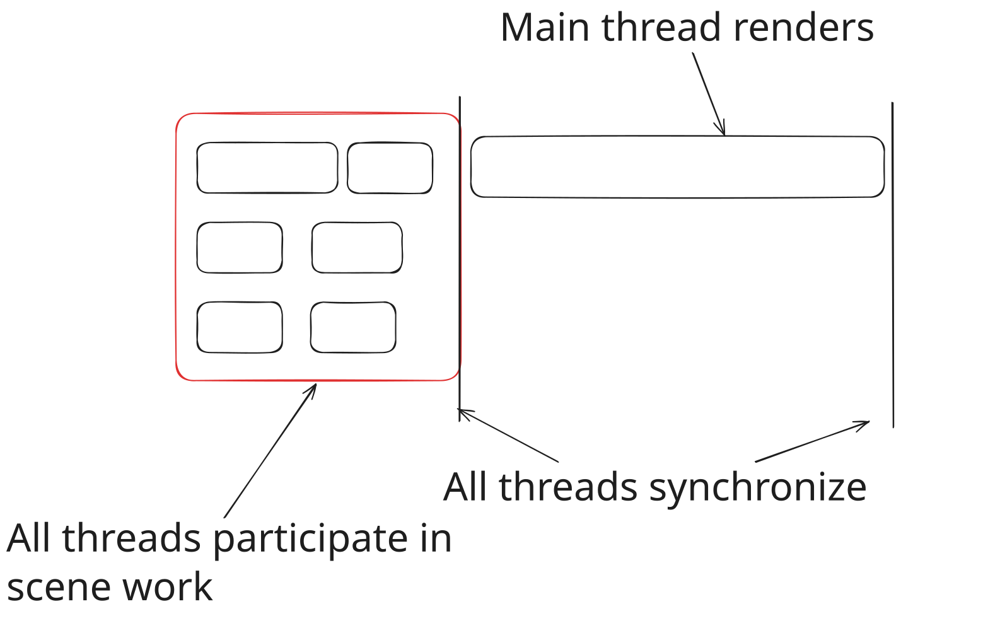
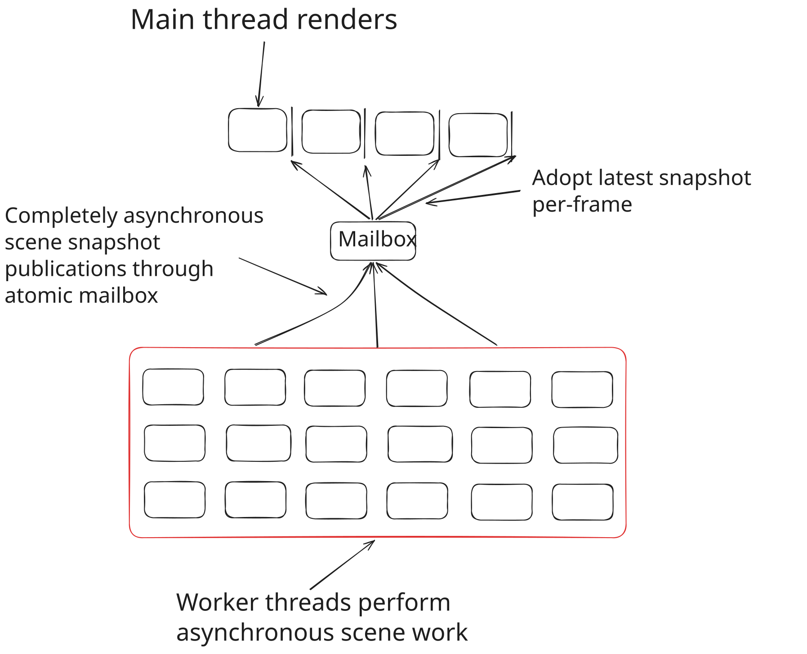
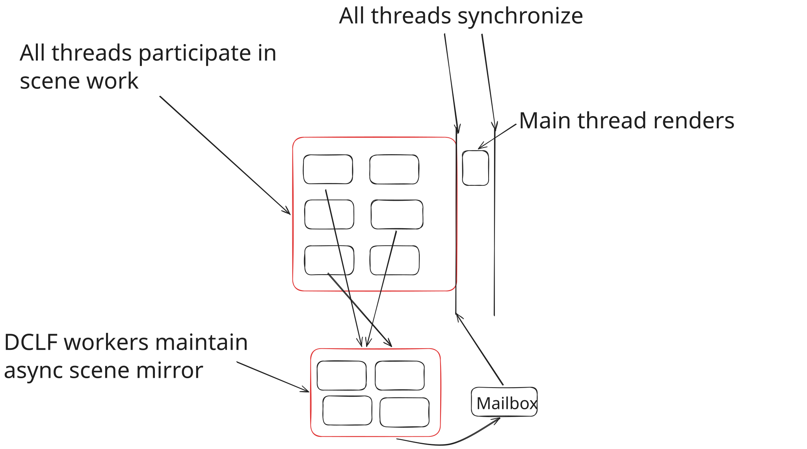
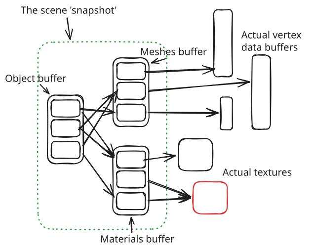
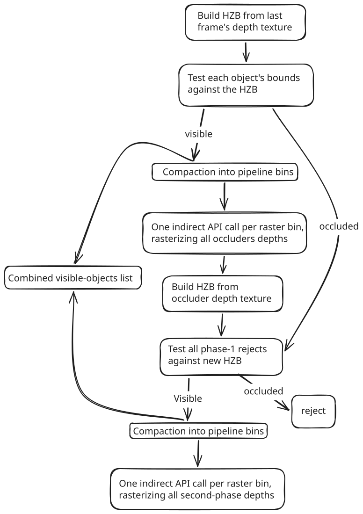

In the last post on this topic we determined that the biggest issue with Skyrim's render pipeline was "the whole thing", and that to make meaningful improvements we would need to restructure it from the ground up. This post follows up on that, with a description of (a) what needs to be replaced, and (b) what the approach will look like. Initially, the goal will be to (effectively) perfectly replicate Skyrim's own native renderer, so that we can thoroughly validate the new GPU-driven pipeline against what the native engine does. Later work will focus on leveraging GPU-driven rendering to go beyond what the native engine is capable of, rather than just faster.

In order to do this, we need to be able to draw an entire Skyrim frame without the native engine's input. Thankfully, CS's existing shaders cover all of Skyrim's materials already, meaning we only need to worry about getting those shaders the inputs they need. This will mostly come down to ensuring our replacement engine has coverage of (a) every type of object the game renders (static objects, actors, trees, LOD, etc.), and (b) every type of view it renders (main camera, shadow views, etc.) and ensuring our GPU-resident scene can represent all of them correctly. This will involve:

- Hooking everything in the native game engine that writes scene state (anything that adds or changes an object or material), turning them into events we can process elsewhere
- Efficiently handling those events without *any* interaction with the main thread, assembling them into a copy of the game's scene that lives in GPU memory.

In order for the end result to be performant, we need to start out with a few hard design rules (running inside Skyrim forces us to bend a few of them for now- more on that at the end):

- *Everything* must be an event. There can be no scene polling.
- Reliance on the base game engine for any frame input other than the camera matrices and other such minimal work is not allowed
- *No* DCLF scene work may occur on the main thread
- *No* synchronization points may be added between DCLF's scene workers and the main thread (the main thread never waits on DCLF work, and vice-versa), or between any DCLF worker tasks.

The full list of features we'll need to implement is below- we'll address the specifics of various subsets as we go.

### Object types

- Normal static objects
- Landscape and landscape LODs
- Object LODs (combined LODs, as DynDOLOD makes)
- Particles
- Faces (facegen)
- Skins (bone-animated meshes, like characters and trees)
- Scrolling-UV (used for ant trails, for example)
- Tree LOD
- Billboards
- Decals
- Effects
- Transparencies
- Grass

### View types:

- Primary color view
- First-person objects (hands, sword)
- Local lights (point, spot)
- Precipitation occlusion
- Skylighting occlusion (CS feature, not base game)
- Volumetric shadows
- Reflection cubemaps
- Directional cascades (sun shadows)
- Focus shadows (character lights)

### Other scene-graph systems which need replacing

Ported to compute shaders:

- Culling (frustum, occlusion, portal-strict)
- Object fade
- Wind-animated foliage

Driven by events on DCLF's scene workers instead of per-frame traversal:

- Hidden objects
- NiSwitchNode

Now, let's get into the systems designed to enable all of this.

## Async scene architecture

We'll define the 'scene' of a game world as 'everything required to produce one game frame, excluding post-processing'. The way the base game manages this is something like below:

A very old-school way of managing scene updates.

The *best* architecture, in my opinion (and what SARP uses), is this:

This completely disconnects game update speed from framerate- Built properly, it is stall-free by construction, as no matter what the worker threads are busy doing (loading new areas, compiling shaders, deforming face meshes, etc.) the main thread *never* waits on them for anything. This is the ideal, but it is a bit optimistic for DCLF. We still need to deal with the fact that we're running inside of Skyrim, and fixing a lot of the other dependencies between the render thread and the rest of the scene work is beyond the scope of this CS feature. As such, for now, we'll need to settle for an intermediate architecture- something like this:

This will alleviate the majority of the expensive main-thread rendering work, without requiring the rest of the render pipeline to migrate to the fully asynchronous system yet (leaving that as an aspirational goal for the rest of CS to migrate to over time). This is also where the compromises to our rules come in- Skyrim was never designed to operate with an asynchronous scene, so many things in the engine are only safe to read on the render thread- and even worse, only safe to read at certain *times*, depending on the current state of execution. This means we *do* need to do some data collection and minimal scene reading (mostly graph root information and character skeleton data) directly on the render thread under its synchronization- alleviating these remaining issues will be the focus of future work.

For now, we'll assume that outside of those few exceptions, we can capture every single scene modification as events (every object addition/removal, every material change, etc.). This is a big assumption, but we'll leave exactly which hooks are necessary for later to focus on the design.

We'll represent our scene as a set of buffers containing information necessary for each "part" of the scene- one for materials, one for geometries, one for drawn instances, etc. They'll be able to point into each other, so we don't need to duplicate data- for instance, each object record will include the index of the material it uses, which itself will point to the texture set used by that material, etc. This allows each object record to remain small, while still being able to reconstruct the entire scene directly on the GPU. A simplified example might look like this:

though in the real thing there is of course much more information to keep track of per object than just meshes and textures. The important parts are:

- Given just the object buffer, any shader can traverse this shallow scene representation to find any piece of information it needs to draw anything in the scene.
- Updating the scene requires simply swapping the pointers used to access the object, material, etc. buffers. If objects are added, materials changed, etc., the worker threads can manage the uploads asynchronously (on a GPU async copy queue), publishing to the snapshot mailbox when ready.

## GPU-side frame execution

Now that we have our scene in GPU memory, we need to be able to use it to draw the scene. There are several steps here, but the important ones are culling, sorting, and rasterization. Since we're going fully GPU-driven, we're going to use depth-only two-pass occlusion culling, then reuse its depth buffer for the color pass: the color draws test depth EQUAL against it and write no depth of their own, so each pixel is shaded once. I'm not going to give a full tutorial on two-pass occlusion- if you want more in-depth discussion, I suggest [this talk from the Alan Wake 2 devs](https://www.youtube.com/watch?v=EtX7WnFhxtQ), and/or [this Medium article](https://medium.com/@mil_kru/two-pass-occlusion-culling-4100edcad501). Starting from the beginning, with the flat list of objects, the culling->depth-only rasterization pipeline works like this:

(note- for views that use Skyrim's portal-strict culling, separate portal passes evaluate it first, and phase 1 reads their verdicts. More on that below.)

This guarantees conservative coverage (no visible object is ever skipped), while avoiding rasterization for objects that are fully occluded. The important outputs from this are:

- The depth buffer
- The combined visible-objects list

With these two things, we can then cull, sort, and draw the color pass, which writes Skyrim's intermediate render targets while testing depth EQUAL against the prepass depths. Particularly knowledgeable students of Computer Graphics may have picked out some remaining inefficiencies in this system- namely:

- We're still rasterizing all visible objects twice
- By tracking occluders from last frame instead of using last frame's depths, we could make culling slightly more efficient in occlusion-heavy scenes, by reducing the number of objects we test twice

These are both correct, and could be addressed with (a) visibility-buffer rendering, and (b) occluder-tracking two-pass occlusion. The first will have to wait until after deferred rendering is finished- the second is easier, and may be implemented before DCLF actually releases.

## Building the Drawcalls

Now that we have our list of objects we want to draw, we need to turn them into actual API drawcalls the GPU can execute. If we just threw them all at the GPU, it would *work*, but the GPU would end up needing to switch shaders between every other call, which would slow it down. Instead, we need to sort it by pipeline (the program the GPU runs to draw the object). 

The initial intent was to use the Device Generated Commands Vulkan extension for all of this, but the preprocessing step turned out to be slower than I'd hoped. If it had been tens of microseconds, I could have hidden it somewhere with async compute, but at hundreds of microseconds for the shadow passes, it was simply too slow compared to just sorting by pipeline and dispatching one indirect drawcall per pipeline. The result is that there are now a few dozen API commands used for rendering the world, rather than just a handful, but the end result is the same with less GPU work. The color pass still uses DGC for now, but that may change depending on how other hardware performs.

In order to support geometry with different vertex layouts under the same pipelines, I also needed to implement 'vertex pulling'. Traditionally, the GPU uses fixed-function hardware to load vertex data into the vertex shader. This is often slightly faster than normal memory loads, but it is also limiting- the pipeline can only accept one vertex format. By skipping this stage and loading the vertex data ourselves, we can use the same pipeline across geometry with slightly different formats.

### Depth-EQUAL rejection to avoid overdraw

The result of the first culling+rasterization pass is just a list of drawcalls and a depth buffer. In order to render the scene colors, we need to execute all the drawcalls again. This time, however, we have an advantage- the preexisting depth buffer can be used to tell the hardware to reject any fragments (pixels of a specific drawcall that end up at a specific texel in the rendered image) before they even run the expensive pixel shader, as long as those fragments would wind up behind what exists in the depth buffer at that same pixel.

This is only possible because we can guarantee that the resulting depths will be bit-perfect between the Z-prepass and lighting pass vertex shaders- otherwise, we would end up with Z-fighting on surfaces where small floating-point differences caused false rejections.

The ability to do this is the justification for the Z prepass- by accepting a little more rasterization cost (rasterizing Skyrim's world is incredibly cheap by the standards of modern GPUs), we can avoid executing the much more expensive lighting shader any more than we absolutely need to.

## Every view from one list

Skyrim draws the same scene many times from different views. The main camera, both directional shadow maps, every point light twice, etc. The game also likes to assign different objects to be visible or not visible in different view types, which means we can't simply render everything in all of them. Since we don't want to maintain an entire separate scene snapshot for each of these views, we instead need a way to filter objects during the culling step to ensure they only appear in views they are supposed to appear in.

The shape this takes is a per-object bitset, which defines the view types it can appear in. During culling, the object's bitset is tested against the view variant we are culling for, and is rejected if it does not participate in that view. This allows us to cheaply reject things we shouldn't draw per-view without maintaining lots of little per-type lists, and adding new view types mid-game is as cheap as possible. Each view type also opts in to different combinations of culling, depending on what is useful for that view

Below is the full list of views DCLF currently takes control of from the engine, and their culling participation:

| View                    | Content                                                 | Culling participation                                     | What it draws            |
| ----------------------- | ------------------------------------------------------- | --------------------------------------------------------- | ------------------------ |
| Main camera             | The image you see                                       | Frustum, portals, and two-pass occlusion                  | Depth, then color        |
| First person            | Character's hands and weapon                            | Not culled (always in view, cheap)                        | Depth, then color        |
| Sun shadow cascades     | Shadows from the sun and moon                           | Only objects that can cast a shadow into the visible area | Depth only               |
| Volumetric shadows      | Shafts of light through fog and haze                    | Select volumetric-enabled geometry                        | Depth only               |
| Spot light shadows      | Shadows from spot lights                                | Frustum                                                   | Depth only               |
| Point light shadows     | Shadows from omnidirectional lights                     | Frustum, plus portals for portal-strict lights            | Depth only               |
| Focus shadows           | Extra-detailed shadows on characters                    | Only the character's own parts                            | Depth only               |
| Skylighting occlusion   | What's blocking the sky, for ambient light (CS feature) | Frustum                                                   | Depth only               |
| Precipitation occlusion | Keeping rain and snow out from under roofs              | Frustum                                                   | Depth only               |
| Reflection cubemaps     | Distant scenery reflected in water                      | Frustum                                                   | Color (distant LOD only) |

Note: the base engine (or CS) still handles water, sky, and a couple of special reflection/refraction cases.

## Decals and transparency

Both decals and transparency require some special-case handling. Let's begin with decals, which are generally used as decoration or variance placed on top of other meshes. They sit directly on the mesh surface, and can't actually occlude anything. As such, they bypass the two-pass occlusion system, and only test against the full-frame HZB. Decal ordering also matters- since they sit on the same plane as the mesh surface they are attached to, any overlapping decals could flicker frame-to-frame if their order were left up to change. Instead, we maintain the same draw order the engine draws them in, to avoid any potential issues with existing content.

Similarly, transparencies cannot occlude anything, so they also skip the prepass. They also need to be sorted- we do not implement a full OIT algorithm here (left for future work), so instead we simply sort them back-to-front and draw them as normal blending-enabled drawcalls.

## How to handle portal-strict lights

Portal culling is a somewhat confusing system compared to occlusion culling. Fundamentally, the question it answers is:

> Given a pre-made room layout (sequences of boxes and doorways, effectively), is this object visible from my position in the room I am currently in?

Portal-strict lights (and portal culling in general) present an interesting problem for a GPU-driven renderer. While we *could* upload the room portal graph to the GPU and traverse it in-shader, it would end up being very branchy (many threads in each wave taking different paths), leading to poor thread coherence and a lot of random VRAM reads (slow). While it might be good *enough*, I decided to go with a more interesting approach. Following the ideas of [Devsh Graphics' 2023 Vulkanised presentation](https://www.vulkan.org/user/pages/09.events/vulkanised-2023/vulkanised_2023_reducing_divergence_with_an_in_shader_jit_virtual_machine_for_material_graphs.pdf) on material graphs, I decided to test out an in-shader virtual machine.

This means that instead of writing normal HLSL code to evaluate a portal graph, we instead write, per room, a stream of bytecode instructions which, when evaluated by a virtual machine, will answer the above question for a given object's bounding sphere.

I'll avoid giving a full description of this system, as it deserves a post unto itself. Suffice to say for now, it works, and is very useful for point lights, but whether having both portal culling and occlusion culling is actually useful for the main camera in a GPU-driven pipeline is questionable at best, given that occlusion culling already grants many of the benefits of portal culling if all we're worried about is cutting rasterization work, with far less complexity.

## TLDR current status:

- Fully covered: static objects, terrain, LOD, characters, trees, decals, transparency; mostly covered: particles, billboards, some effects; still drawn by the engine: grass, water, sky.
- Performance: CPU limit lifted *until* it hits the separate animation synchronization limit. Performance marginally slower than native renderer in GPU-bound scenarios (varies somewhat based on scene content, particularly bad in interiors, which are very simple). This will be improved upon.

## Next time

- Part 3: how the GPU scene is kept up to date: hooking the engine, turning changes into events, and several things DCLF needs to reimplement to keep the rest of the engine up-to-date when its normal scene lists are missing all of their entries and CPU culling no longer operates on them.
- Later: the portal in-shader virtual machine in more depth

